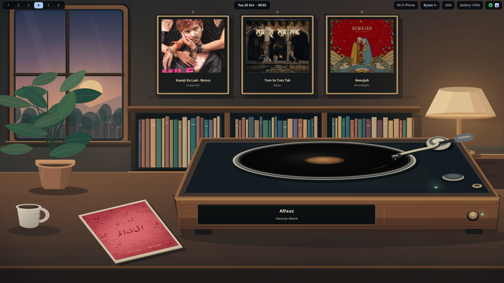

# Needle

Animated vinyl wallpaper for Linux. Needle draws a listening room, spins a record while music plays, and reads track metadata and cover art from MPRIS players.



## Build and run

On Debian or Ubuntu, install the build dependencies and run Needle:

```sh
sudo apt install build-essential pkg-config libgtk-3-dev libgtk-layer-shell-dev libsoup-3.0-dev
make
./needle
```

Install to `/usr/local` with `sudo make install`.

## Desktop support

- **Tested:** Niri on Wayland.
- **Wayland:** Requires layer-shell. Hyprland should work but has not been verified. GNOME Wayland is unsupported.
- **X11:** Not tested.
- **macOS:** Not supported.

Needle creates one wallpaper window per monitor. The window does not take pointer input, so desktop icons remain usable. Track artwork and metadata update immediately when the player changes tracks. Three previous tracks appear in the wall frames during each session.

## Planned

User-made and community-contributed scenes are planned for the near future if there is interest.

## Settings

Edit `~/.config/needle/config.ini`; Needle creates the file on first launch and applies edits immediately. There is no settings window.

```ini
[Needle]
framing=mid
transparent-background=false
show-art=true
show-title=true
show-artist=true
show-album=true
show-status=false
show-player=false
hide-paused=false
launch-login=false
```

| Setting | Values | Effect |
| --- | --- | --- |
| `framing` | `wide`, `mid`, `close` | Sets the scene crop. |
| `transparent-background` | `true`, `false` | Draws only the record, covers, sleeve, and player display when enabled. |
| `show-art` | `true`, `false` | Shows covers in the wall frames and on the sleeve. |
| `show-title`, `show-artist`, `show-album` | `true`, `false` | Shows selected track fields on the turntable display. |
| `show-status`, `show-player` | `true`, `false` | Adds playback status or player name to that display. |
| `hide-paused` | `true`, `false` | Hides the scene when playback is stopped or paused. |
| `launch-login` | `true`, `false` | Adds or removes Needle from this user's XDG autostart. |

Needle reads local artwork and HTTP(S) artwork URLs from the player. Remote downloads time out after eight seconds and are limited to 12 MiB.

## License

Needle is licensed under the GNU General Public License v3.0 or, at your option, any later version. See [LICENSE](LICENSE).
